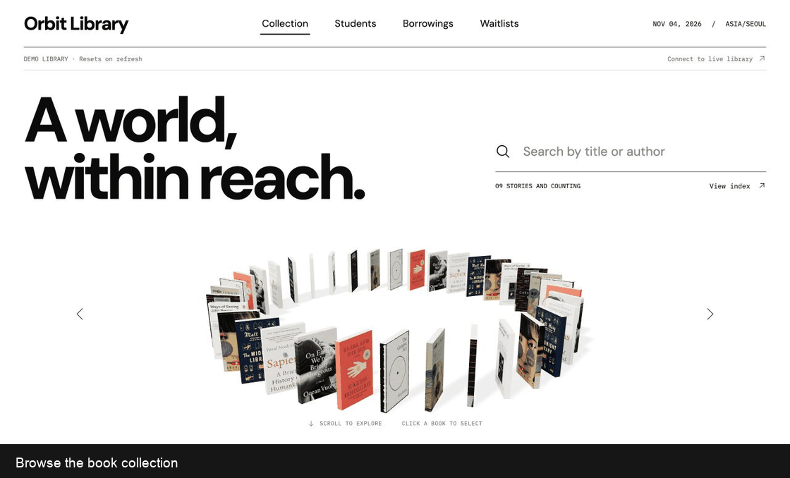
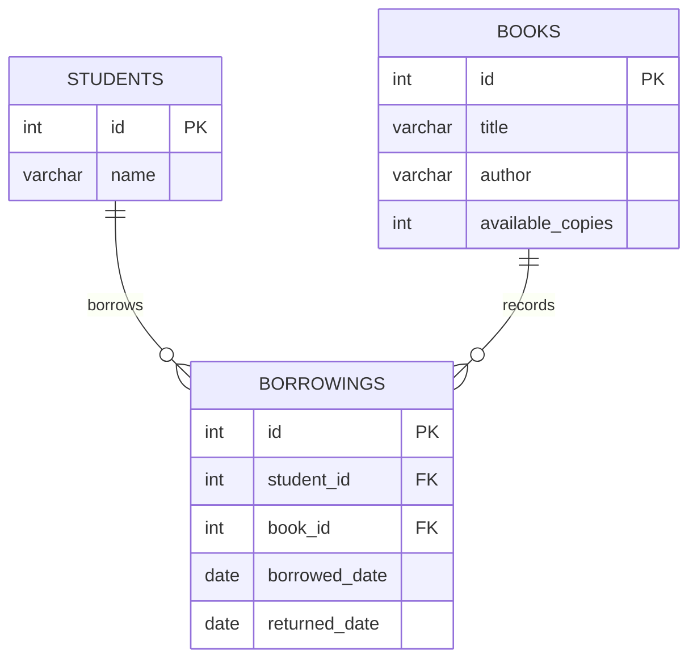
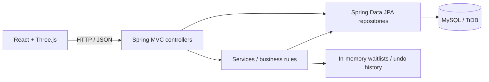

# Orbit Library · Library Management System

Orbit Library is a full-stack library database management application built with Java, Spring Boot, and React. It provides a REST API and an interactive book collection for cataloguing books, registering students, borrowing, and returning.

[Explore the demo](https://orbit-library.onrender.com/?demo) $\cdot$ [live library](https://orbit-library.onrender.com)



## Features

| Area | What you can do |
| --- | --- |
| Book collection | Add, view, edit, and delete books; search the collection; update available copies |
| Students | Register readers, view the student list, edit names, and delete eligible records |
| Borrowings | Borrow an available book, view current loans, and return a book |
| Waitlists | Join a book's queue when no copies are available, view the next reader, and remove the next entry |
| Book edits | Undo the most recent book-details edit while its in-memory history is available |
| Interface | Start from a home screen with search above an interactive 3D orbit; browse the collection in orbit or index view beside a catalog record. Upload a cover for any book; demo titles otherwise use matching artwork, and other books get a typeset cover with their title and author |

Records referenced by borrowing history cannot be deleted. Returning a book restores one available copy; it does not automatically lend the book to the next person in a waitlist.

## ER Model



Each borrowing belongs to one student and one book. A null `returned_date` identifies an active loan; returned loans remain in the database as history.

Waitlists are held separately in a Java map of queues, with one queue per book. They are not database entities.

## Architecture



Controllers handle HTTP requests and input validation. Services coordinate business rules such as borrowing, returns, and edit history. Repositories read and update relational records through Spring Data JPA.

## Data Access & Database

- **Persistence:** JPA entities map to `books`, `students`, and `borrowings`. Repositories combine inherited JPA operations with explicit JPQL queries.
- **Borrowing:** A conditional update decreases stock only when a copy is available. The stock update and borrowing insert run in one transaction, so a failed insert rolls both operations back.
- **Returns:** Only the request that marks an active loan as returned restores a copy, preventing repeated returns from increasing stock twice.
- **Queries:** Current borrowings use a joined DTO projection, so the API returns reader and book details without serializing lazy entity relationships.
- **Schema:** The local and cloud profiles use `ddl-auto=validate`. Tables must exist before startup; the application does not create or alter them automatically.
- **Storage:** Local development uses MySQL. The deployed app uses TiDB Cloud's MySQL-compatible endpoint with TLS certificate verification. Backend tests use a separate H2 database.

## Tech Stack

| Layer | Technologies |
| --- | --- |
| Backend | Java 25, Spring Boot, Spring Data JPA |
| Frontend | React, Vite, Three.js |
| Database | MySQL / TiDB; H2 for tests |
| Deployment | Docker, Render, GitHub Actions |

## Run Locally

Requires JDK 25, Node.js 22, and MySQL.

1. Clone the repository and prepare the `library` database with the required tables, then run `docs/book-covers.sql` once.
2. Set `DB_PASSWORD` in your environment. The default database connection is `localhost:3306/library`, with username `root`.
3. Start the backend and frontend in separate terminals from the repository root:

```bash
# Backend
cd library
./mvnw spring-boot:run
```

```bash
# Frontend
cd frontend
npm ci
npm run dev
```

Open [localhost:5173](http://localhost:5173). For frontend-only demo mode, use [localhost:5173/?demo](http://localhost:5173/?demo); no backend or database is required.

## API Overview

| Method | Endpoint | Purpose |
| --- | --- | --- |
| GET | `/books` | List books; optional `?title=` filters by exact title |
| GET | `/books/{id}` | View one book |
| POST | `/books` | Add a book |
| PATCH | `/books/{id}` | Update title and author |
| PATCH | `/books/{id}/copies` | Set available copies |
| DELETE | `/books/{id}` | Delete an eligible book |
| POST | `/books/undo` | Undo the last book-details edit |
| GET | `/books/covers` | List which books have uploaded covers, with each cover's version |
| GET | `/books/{id}/cover` | Read an uploaded cover image |
| PUT | `/books/{id}/cover` | Upload or replace a cover: raw JPEG, PNG, or WebP bytes up to 2 MB |
| DELETE | `/books/{id}/cover` | Remove an uploaded cover |
| GET / POST | `/students` | List or register students |
| PATCH / DELETE | `/students/{id}` | Edit or delete a student |
| GET / POST | `/borrowings` | List current loans or borrow a book |
| PATCH | `/borrowings/{id}/return` | Return a borrowed book |
| POST | `/books/{bookId}/waitlist` | Join a book's waitlist |
| GET | `/books/{bookId}/waitlist/next` | View the next reader |
| POST | `/books/{bookId}/waitlist/next/remove` | Remove the next queue entry |

## Tests

Run each set of commands from the repository root:

```bash
# Backend
cd library
./mvnw verify
```

```bash
# Frontend
cd frontend
npm ci
npm test
npm run test:sites
```
