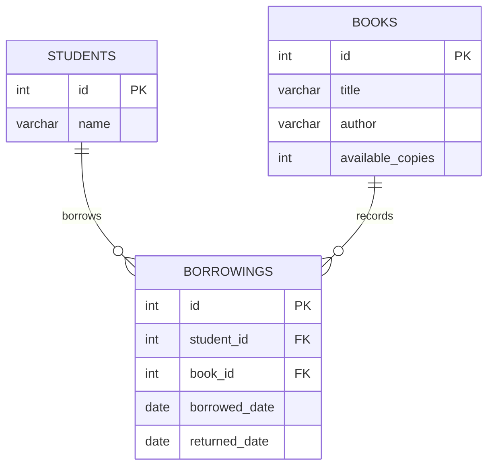
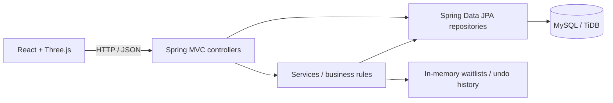

# Orbit Library · Library Management System

**A world within reach.**

A full-stack library management application built with Java, Spring Boot, and React. Orbit Library turns everyday library tasks—cataloguing books, registering students, borrowing, and returning—into a REST API with an interactive book collection.

[**Open the live app →**](https://orbit-library.onrender.com/) · [Explore the demo](https://orbit-library.onrender.com/?demo) · [Spring Petclinic inspiration](https://github.com/spring-projects/spring-petclinic)

## About the project

This CRUD project was inspired by [Spring Petclinic](https://github.com/spring-projects/spring-petclinic), a sample Spring application. I used the idea of a small, familiar domain to practise how controllers, services, repositories, and database entities work together, applying those concepts to a library.

The project explores REST API design, dependency injection, relational data modelling, JPA queries, transaction boundaries, and a frontend that connects those pieces into a usable application.

## Preview

> **App walkthrough / GIF — coming soon**
>
> A space for a short walkthrough of the collection, student registration, and borrowing flow. In the meantime, try the [live application](https://orbit-library.onrender.com/) or the [isolated demo](https://orbit-library.onrender.com/?demo).

The demo includes nine sample books and fictional readers. Demo changes stay in memory in the browser and reset on reload; the live app uses the cloud database.

## Features

| Area | What you can do |
| --- | --- |
| Book collection | Add, view, edit, and delete books; search the collection; update available copies |
| Students | Register readers, view the student list, edit names, and delete eligible records |
| Borrowings | Borrow an available book, view current loans, and return a book |
| Waitlists | Join a book's queue when no copies are available, view the next reader, and remove the next entry |
| Book edits | Undo the most recent book-details edit while its in-memory history is available |
| Interface | Browse books in an interactive 3D orbit or index view, with matching cover artwork for the demo titles |

Records referenced by borrowing history cannot be deleted. Returning a book restores one available copy; it does not automatically lend the book to the next person in a waitlist.

## ER model / domain model



Each borrowing belongs to one student and one book. A null `returned_date` identifies an active loan; returned loans remain in the database as history.

Waitlists are held separately in a Java map of queues, with one queue per book. They are not database entities.

## Architecture



Controllers handle HTTP requests and input validation. Services coordinate business rules such as borrowing, returns, and edit history. Repositories read and update relational records through Spring Data JPA.

### Data access & database

- **Persistence:** JPA entities map to `books`, `students`, and `borrowings`. Repositories combine inherited JPA operations with explicit JPQL queries.
- **Borrowing:** A conditional update decreases stock only when a copy is available. The stock update and borrowing insert run in one transaction, so a failed insert rolls both operations back.
- **Returns:** Only the request that marks an active loan as returned restores a copy, preventing repeated returns from increasing stock twice.
- **Queries:** Current borrowings use a joined DTO projection, so the API returns reader and book details without serializing lazy entity relationships.
- **Schema:** The local and cloud profiles use `ddl-auto=validate`. Tables must exist before startup; the application does not create or alter them automatically.
- **Storage:** Local development uses MySQL. The deployed app uses TiDB Cloud's MySQL-compatible endpoint with TLS certificate verification. Backend tests use a separate H2 database.

## Tech stack

| Layer | Technologies |
| --- | --- |
| Backend | Java 25, Spring Boot 4.1.1, Spring MVC, Spring Data JPA / Hibernate |
| Frontend | React 19, Vite, Three.js, Phosphor Icons |
| Database | MySQL-compatible TiDB Cloud; H2 for backend tests |
| Build & tests | Maven Wrapper, Node.js 22, Node test runner, Playwright |
| Deployment | Multi-stage Docker image, Render, GitHub Actions |

## Run locally

### Prerequisites

- JDK 25
- Node.js 22 and npm
- A running MySQL database

Clone the repository:

```bash
git clone https://github.com/sophiasuebeen/library-management-system.git
cd library-management-system
```

### 1. Create the database tables

On a **new, empty local database**, run the following SQL. For an existing database, review its schema instead of recreating tables.

```sql
CREATE DATABASE library;
USE library;

CREATE TABLE books (
    id INT AUTO_INCREMENT PRIMARY KEY,
    title VARCHAR(255) NOT NULL,
    author VARCHAR(255) NOT NULL,
    available_copies INT NOT NULL
);

CREATE TABLE students (
    id INT AUTO_INCREMENT PRIMARY KEY,
    name VARCHAR(255) NOT NULL
);

CREATE TABLE borrowings (
    id INT AUTO_INCREMENT PRIMARY KEY,
    student_id INT NOT NULL,
    book_id INT NOT NULL,
    borrowed_date DATE NOT NULL,
    returned_date DATE,
    FOREIGN KEY (student_id) REFERENCES students(id),
    FOREIGN KEY (book_id) REFERENCES books(id)
);
```

### 2. Start the backend

The default configuration connects to `jdbc:mysql://localhost:3306/library` as `root`. Set `DB_PASSWORD` in your terminal or IDE environment to your local database password before starting the app. You can override the URL and username with `SPRING_DATASOURCE_URL` and `SPRING_DATASOURCE_USERNAME`.

```bash
cd library
./mvnw spring-boot:run
```

The API runs at [localhost:8080](http://localhost:8080). On Windows, use `mvnw.cmd`.

### 3. Start the frontend

In another terminal, from the repository root:

```bash
cd frontend
npm ci
npm run dev
```

Open [localhost:5173](http://localhost:5173). Vite proxies `/books`, `/students`, and `/borrowings` to the backend on port 8080.

To explore only the frontend, open [localhost:5173/?demo](http://localhost:5173/?demo). Demo mode does not require the backend or a database.

## API overview

| Method | Endpoint | Purpose |
| --- | --- | --- |
| GET | `/books` | List books; optional `?title=` filters by exact title |
| GET | `/books/{id}` | View one book |
| POST | `/books` | Add a book |
| PATCH | `/books/{id}` | Update title and author |
| PATCH | `/books/{id}/copies` | Set available copies |
| DELETE | `/books/{id}` | Delete an eligible book |
| POST | `/books/undo` | Undo the last book-details edit |
| GET / POST | `/students` | List or register students |
| PATCH / DELETE | `/students/{id}` | Edit or delete a student |
| GET / POST | `/borrowings` | List current loans or borrow a book |
| PATCH | `/borrowings/{id}/return` | Return a borrowed book |
| POST | `/books/{bookId}/waitlist` | Join a book's waitlist |
| GET | `/books/{bookId}/waitlist/next` | View the next reader |
| POST | `/books/{bookId}/waitlist/next/remove` | Remove the next queue entry |

For example, send this JSON to `POST /books`:

```json
{
  "title": "The Creative Act",
  "author": "Rick Rubin",
  "copies": 3
}
```

## Tests

Backend tests run against H2 and do not require production database credentials:

```bash
cd library
./mvnw -B -ntp verify
```

Frontend checks and production build:

```bash
cd frontend
npm ci
npm test
npm run test:sites
npm run build
```

For browser tests, install Chromium with `npx playwright install chromium --no-shell`, run `npm run dev` in another terminal, and run `npm run test:browser`. The browser suite exercises the isolated demo.

GitHub Actions builds the Docker image, runs the included frontend and Java checks, and runs browser flows and mobile-layout checks.

## Deployment

The root [Dockerfile](Dockerfile) builds React and packages its output with the Spring Boot application. Render serves the frontend and API from the same origin; TiDB stores the persistent library records.

[render.yaml](render.yaml) defines the free Docker web service and the `/books` health check. The cloud profile requires these environment variables:

| Variable | Purpose |
| --- | --- |
| `SPRING_PROFILES_ACTIVE` | Set to `cloud` |
| `DB_URL` | MySQL JDBC URL for the `library` database, including verified TLS settings |
| `DB_USERNAME` | Database username from TiDB's Connect panel |
| `DB_PASSWORD` | Database password generated in TiDB |

Keep credentials in Render's environment settings and out of source control. The database password is separate from a TiDB Cloud API key.

## Current scope

This is a learning and portfolio project. The public app currently has no authentication or authorization, so use fictional data: anyone with the URL can read and modify records.

Books, students, and borrowing history persist in the database. Waitlists and undo history are held in server memory and reset when the service restarts, redeploys, or spins down. Render's free instance can sleep during inactivity, so the first request may take longer.

## Acknowledgements

- [Spring Petclinic](https://github.com/spring-projects/spring-petclinic) — inspiration for learning Spring through a practical domain-based CRUD project.
- Cover artwork sources are documented in [frontend/public/covers/SOURCES.md](frontend/public/covers/SOURCES.md).
